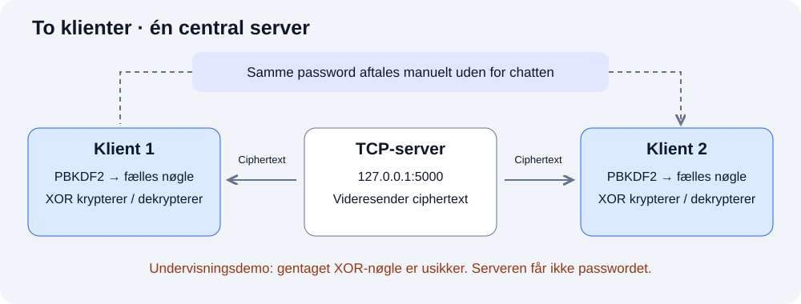
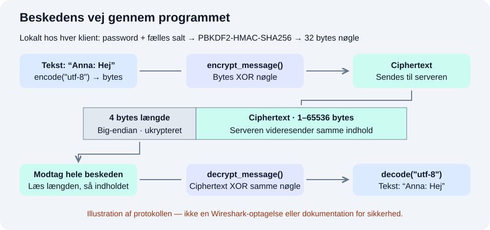

# Mandatory Assignment One – Applied Cryptography

## Formål og implementerede krav

En simpel terminalchat i Python 3 med en central TCP-server og mindst to klienter. Projektet demonstrerer PBKDF2-HMAC-SHA256 til nøgleafledning og XOR til kryptering/dekryptering. Det er et undervisningsprojekt, **ikke sikker end-to-end-kryptering eller en sikker One-Time Pad**. Brug det ikke til følsomme oplysninger.

Implementeret: brugernavn, manuelt aftalt password, nøgleafledning, XOR før afsendelse og efter modtagelse, TCP-beskeder med længdeangivelse, videresendelse uden dekryptering og håndtering af afbrudte klienter. Kun Pythons standardbibliotek bruges.

## Arkitektur og TCP



Arkitekturen tager udgangspunkt i [underviserens GitHub-reference](https://github.com/catmfoo/python-client-server): sockets, modtagetråde og videresendelse til andre klienter. Her tilføjes PBKDF2, XOR og længdeindramning, og korte funktioner erstatter referencens klientklasse.

Begge klienter aftaler passwordet manuelt uden for chatten. Hver klient afleder selv nøglen. Hverken password eller nøgle sendes til serveren. Klienten omdanner `brugernavn: besked` til UTF-8 og XOR-krypterer disse bytes. Serveren videresender ciphertext uændret til alle andre tilsluttede klienter. Med to klienter går beskeden kun til den anden klient. Afsenderen får ikke sin egen besked tilbage.

TCP er en byte-stream: én afsendelse kan blive opdelt, og flere afsendelser kan blive samlet. Derfor har hver besked formatet:

`[4 bytes længde, big-endian][ciphertext med den angivne længde]`

Længden angiver kun ciphertextens antal bytes. Læseløkken samler præcis det angivne antal bytes. Maksimum er 65536 bytes inklusive brugernavn og separator; ugyldige længder lukker forbindelsen. Headeren er ikke krypteret.

Serveren bruger én `threading.Thread` pr. klient. En lås beskytter klientlisten, og en lås pr. modtager forhindrer samtidige afsendere i at blande beskeder. Klienten bruger en modtagetråd, så beskeder kan vises, mens hovedtråden venter i `input()`. Et `threading.Event` markerer afbrudt forbindelse. Da `input()` venter på terminalinput, skal man trykke Enter for at afslutte efter serverafbrydelse.

Klienten importerer TCP-hjælpefunktioner fra `server.py`, så protokollen kun defineres ét sted. Importen starter ikke serveren: opstarten ligger under `if __name__ == "__main__"`.

## PBKDF2, SHA-256, salt og iterationer

`hashlib.pbkdf2_hmac()` afleder 32 bytes nøglemateriale fra passwordets UTF-8-bytes. PBKDF2 bruger HMAC med SHA-256, et offentligt salt og gentagne beregninger. SHA-256 er en hashfunktion, ikke en krypteringsalgoritme. Iterationerne gør hvert passwordgæt mere beregningstungt; de gør ikke et svagt password sikkert.

Begge klienter bruger de samme konstanter:

- Salt: `b"mandatory-one-demo-salt"`
- Hashfunktion: `sha256`
- Iterationer: `100_000` (opgavens parameter, ikke en anbefaling til produktionssikkerhed)
- Nøglelængde: 32 bytes

Samme password og parametre giver samme nøgle. Saltet er ikke hemmeligt. Normalt bruges forskellige tilfældige salte til at undgå genbrug af forudberegninger på tværs af afledninger. Her er saltet fast for at holde demonstrationen enkel; samme password giver derfor samme nøgle på tværs af alle kørsler. Passwordet læses med `getpass`, så det ikke vises i terminalen.

## XOR og begrænsninger



Billederne er forklarende diagrammer, ikke screenshots af en udført netværkstest.

`encrypt_message(message, key)` tager tekst, bruger `.encode("utf-8")` og XOR og returnerer ciphertext som bytes. `decrypt_message(ciphertext, key)` bruger XOR med samme nøgle og `.decode("utf-8")` og returnerer teksten. Begge bruger hjælpefunktionen `xor_bytes()`.

Hver byte kombineres med en nøglebyte via `^`. Efter 32 bytes gentages nøglen:

`ciphertext[i] = plaintext[i] ^ key[i % len(key)]`

Samme operation dekrypterer, fordi `(x ^ k) ^ k = x`. PBKDF2 afleder nøglen; XOR udfører selve demonstrationen af kryptering.

**Genbrug af nøglemateriale med XOR er usikkert.** Ved samme nøgle gælder `C1 XOR C2 = P1 XOR P2`, hvilket afslører relationer mellem beskeder. Kendt tekst kan afsløre nøglemateriale. En rigtig OTP kræver en tilfældig, hemmelig nøgle, der er lige så lang som beskeden og kun bruges én gang. Denne løsning opfylder ikke det krav.

Der er ingen integritetskontrol eller autentifikation. Beskeder kan ændres, og brugernavne kan efterlignes. Forkert password kan give en UTF-8-fejl, men kan også give læsbar, forkert tekst; programmet kan ikke pålideligt opdage forkert password eller manipulation. Serveren har ikke nøglen, men det er ikke en garanti mod analyse af den svage kryptering.

Serveren kan se forbindelser, længder og tidspunkter. Der er ingen beskedhistorik, kø til offline-klienter eller automatisk genforbindelse. Begge klienter skal være forbundet før afsendelse. En langsom modtager kan blokere videresendelse. Løsningen er til en lille lokal demonstration, ikke produktion. Modtagne beskeder kan visuelt afbryde terminalens inputlinje.

## Installation og start i VS Code

Åbn projektmappen i VS Code. Installer uv, hvis kommandoen ikke allerede findes. Åbn tre terminaler via **Terminal → New Terminal**, alle i projektmappen. Projektets `.python-version` vælger Python 3.13.

Kør først:

```powershell
uv sync
```

Terminal 1 – start serveren:

```powershell
uv run server.py
```

Terminal 2 og terminal 3 – start én klient i hver:

```powershell
uv run client.py
```

Indtast forskellige brugernavne og præcis samme manuelt aftalte password. Passwordindtastningen vises ikke. Vent, til begge klienter siger `Forbundet`. Send en besked fra klient 1, kontrollér den i klient 2, og send et svar den anden vej. Prøv også danske tegn som `æøå`. Skriv `/quit` for at lukke en klient, og kontrollér, at serveren fortsætter. Stop serveren med Ctrl+C.

Hvis porten er optaget, skal den tidligere server stoppes. Hvis uv ikke kan bruge sin normale cache, kan denne kommando køres i den pågældende PowerShell-terminal før uv-kommandoerne:

```powershell
$env:UV_CACHE_DIR = Join-Path $env:TEMP 'crypto-mandatory-uv-cache'
```

## Udførte tests

Under ombygningen blev `uv sync` og en midlertidig Python-test via `uv run python -` kørt. Testen startede den faktiske server som en separat proces og forbandt to TCP-testklienter, som brugte projektets krypterings- og protokolfunktioner.

Følgende bestod:

1. Serveren starter og accepterer to klienter.
2. Beskeder sendes og dekrypteres korrekt i begge retninger, også med danske tegn.
3. De afsendte bytes er ciphertext og adskiller sig fra plaintext.
4. Serveren videresender ciphertext uændret uden at kende passwordet.
5. Samme password giver samme nøgle; to forskellige testpasswords giver forskellige nøgler.
6. Normal afbrydelse og afbrydelse midt i en header får ikke serveren til at stoppe; en ny klient kan fortsætte chatten.
7. To beskeder sendt samlet læses separat. En separat deterministisk test med én byte pr. `recv()` kontrollerer opdelt header og indhold.
8. Den opdaterede løsning med 100.000 iterationer sender flere beskeder på samme forbindelse i begge retninger, inklusive beskeder på 65536 bytes.
9. Tre testklienter bekræfter videresendelse til alle andre klienter. En ugyldig længde lukker kun den berørte forbindelse.

Den seneste test startede serveren med `uv run server.py`. Kommunikationskontrollerne bestod. Testens oprydning ramte først en timeout; efterfølgende blev testens procestræ stoppet, og port 5000 blev bekræftet ledig. Filkontroller blev kørt separat. `uv sync --locked` bestod også.

Tests bruger automatiserede TCP-klienter, ikke manuel indtastning i to VS Code-terminaler. Den manuelle terminaltest og Wireshark-testen skal I selv udføre. Der er ikke tilføjet en permanent testsuite for at holde projektstrukturen enkel.

## Manuel Wireshark-test

1. Start serveren som beskrevet ovenfor.
2. Åbn Wireshark, og vælg loopback-interfacet, fordi adressen er `127.0.0.1`. På Windows/Npcap hedder det typisk **Adapter for loopback traffic capture** eller noget med **Loopback**. Et almindeligt Wi-Fi-interface viser normalt ikke denne lokale trafik.
3. Start optagelsen, og start derefter begge klienter.
4. Brug displayfilteret `tcp.port == 5000`.
5. Send en genkendelig testbesked. Find en pakke med TCP-data, ikke kun en ACK. Filteret `tcp.port == 5000 && tcp.len > 0` kan hjælpe.
6. Udvid TCP og markér payload/data; se bytes i **Packet Bytes**. De første fire bytes i en komplet besked angiver længden, og resten er ciphertext. TCP kan opdele beskeden over flere pakker; **Follow → TCP Stream** med hex-visning kan hjælpe med at se den samlede strøm.
7. Tag selv et screenshot med filter, valgt pakke og ciphertext synlig i datafeltets hex-visning. Tilfældige læsbare tegn kan forekomme; det er ikke et tegn på sikker kryptering, at hele teksten ikke umiddelbart kan læses.
8. Stop optagelsen. Beskriv jeres egne observationer i afleveringen.

Der er ikke udført Wireshark-optagelse eller lavet screenshots som del af ombygningen.

## Filer og aflevering

- `client.py`: terminalinput, PBKDF2, XOR og modtagetråd.
- `server.py`: TCP-protokol og videresendelse.
- `README.md`: denne vejledning.
- `docs/`: to SVG-illustrationer til README; kræver ingen Python-afhængigheder.
- `pyproject.toml`, `.python-version`, `uv.lock`: uv-konfiguration uden eksterne afhængigheder.

Den gamle Fernet-klient `client (1).py` og uv-demofilen `main.py` er fjernet efter gennemlæsning. Git-historikken er bevaret.

PDF'en udarbejdes separat og må højst fylde to sider. Den endelige ZIP skal **kun** indeholde `client.py`, `server.py` og `documentation.pdf`. Medtag ikke `.venv`, `.git`, cachemapper, `docs/`, README eller uv-filer i afleverings-ZIP'en. PDF og ZIP er ikke oprettet her.

## Sådan gennemgår I koden

Læs først `derive_key()`, dernæst `encrypt_message()` og `decrypt_message()`. Følg derefter en besked gennem `send_message()`, serverens `handle_client()` og `broadcast()` og til sidst klientens `receive_messages()`. Kontrollér, at kun ciphertext passerer serveren, og forklar, hvorfor samme XOR-operation genskaber teksten. Åbn README-preview i VS Code med Ctrl+Shift+V for at se illustrationerne.
